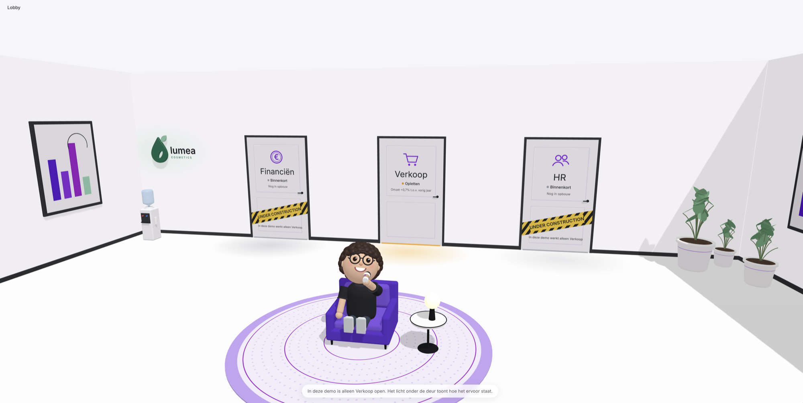
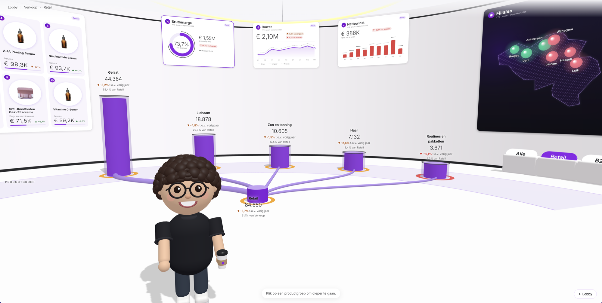
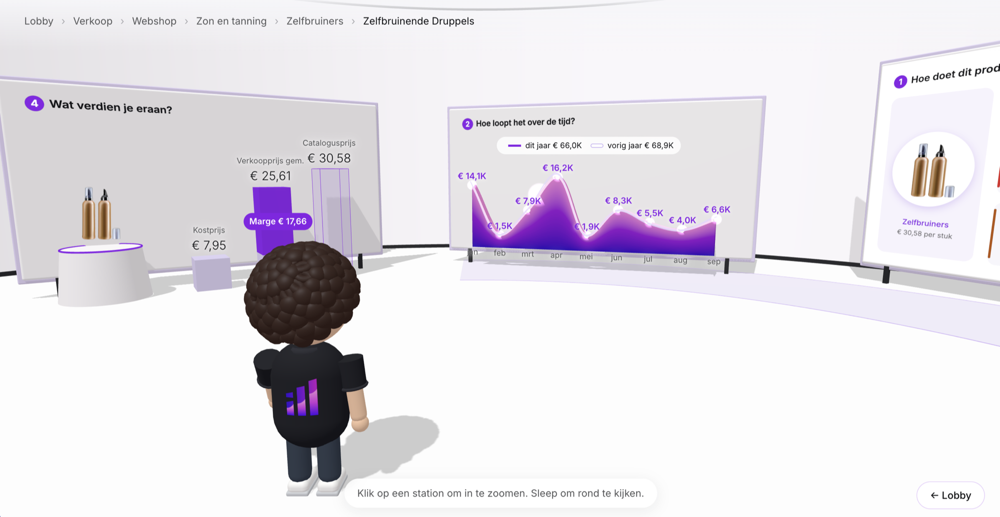

# Immersive Sales Room

A 3D sales dashboard you walk through, built as a [Fabric App](https://aka.ms/rayfin/docs) with Rayfin.
An avatar guides you from a lobby into a sales room: KPI cards on the wall, a store map of Belgium,
a Top 10, and a decomposition tree on the floor that unfolds from channel to a single product,
with a product room at the end.

Every figure comes from DAX measures on a Fabric **semantic model**. Without a model, the app runs
on bundled sample data: an export of exactly the same queries.

<!-- Screenshots: add docs/lobby.png, docs/zaal.png and docs/product.png (1440 × 900 or larger). -->
| Lobby | Sales room | Product room |
|---|---|---|
|  |  |  |

▶ **[Watch the walkthrough on LinkedIn](https://www.linkedin.com/posts/g-moureau_due-to-an-accident-im-stuck-behind-my-computer-ugcPost-7520506159024316416-s2Cf/)**

> The brand "lumea cosmetics", its products and all figures are fictitious demo data.
> The interface is in Dutch.

## What it shows

| Part | What you see | Where the data comes from |
|---|---|---|
| **Lobby** | One door per domain. Only *Verkoop* (sales) is open in this demo; the light under the door shows `[Status]` of the year to date. | Control query 5.2 |
| **KPI cards** | Revenue, gross margin and net profit, each against last year and forecast. A click opens a detail card: revenue per month with a running total, a margin gauge with cost versus margin per month, and a waterfall from revenue to net profit. | `kerncijfersMaandQuery` |
| **Slicers** | Alle · Retail · B2B · Webshop. Cards, map, Top 10 and tree follow. | `dim_kanaal[kanaal]` |
| **Store map** | A bubble per store (size = revenue, colour = `[Status]`), a ranking and the top 3 products per store. Brussels is the central warehouse for B2B and Webshop. | `filialenQuery`, `toppersQuery` |
| **Top 10** | The best-selling products with photo, revenue and growth. A tile opens the product room. | `top10Query` |
| **Decomposition tree** | Verkoop › Kanaal › Productgroep › Subgroep › Product, with units, last year and growth at every step. | `boomQuery` |
| **Product room** | Key figures against last year, revenue per month, units per channel and store, price build-up and margin, rank and rank last year. Loaded on demand with four small queries. | `ficheQueries` |

Status colours always come from the `[Status]` measure (revenue growth above +3 % is green, below −3 % red,
orange in between); the app does not recompute that rule. A plain difference, such as against forecast,
is tinted by its sign only.

## Getting started

### Prerequisites

- Node.js 20 or later and npm
- For the live mode: a Microsoft Fabric workspace with capacity, and a semantic model with the tables
  and measures listed under [The semantic model](#the-semantic-model)

### Run it on the sample data

```sh
npm install
npm run dev:frontend
```

Open <http://localhost:5173/?bron=voorbeeld>. No Fabric sign-in is needed on the sample data.
To make the sample data the default, set `VITE_DATABRON=voorbeeld`.

### Connect your own semantic model

1. Point the connector at your model. `rayfin/rayfin.yml` already declares a connector called
   `verkoop` (the name the app uses) with placeholder IDs. Replace them, or let the CLI verify the
   model and write them for you:

   ```sh
   npx rayfin connector remove verkoop
   npx rayfin connector add --type fabric-semanticmodel --workspace-id <workspace-id> --item-id <semantic-model-id> --name verkoop
   ```

   The connector uses delegated authentication: every query runs as the signed-in user,
   so no secrets are stored in the app.

2. Check the model. This runs control query 5.2 through the CLI and compares the totals:

   ```sh
   npm run check:model
   ```

   The expected totals are in `checks/kerncijfers-5.2.verwacht.json`. Update them for your own data.

3. Deploy to your workspace:

   ```sh
   npx rayfin up --workspace-id <workspace-id> --item-name "Immersive Sales Room"
   ```

   `rayfin up` prints the hosted URL and adds it to `allowedRedirectUris` in `rayfin/rayfin.yml`.

4. After the first deploy, `npm run dev:frontend` also runs live locally against the model.

To refresh the sample data from your model: `npm run export:voorbeeld`.

## The semantic model

The app only reads; it never changes the model. All queries are small `SUMMARIZECOLUMNS` queries
that let the model aggregate. They use these names:

**Tables and columns**

| Table | Columns used |
|---|---|
| `dim_kanaal` | `kanaal` (Retail, B2B, Webshop) |
| `dim_datum` | `jaar`, `maand_nr`, `maandnaam` (marked as date table, for the last-year measures) |
| `dim_product` | `product_id`, `product`, `productgroep`, `subgroep`, `catalogusprijs`, `kostprijs_per_stuk`, `foto_url` |
| `dim_filiaal` | `filiaal`, `lon`, `lat`, `is_centraal` |
| `fact_verkoop` | `product_id` (for the number of products sold) |

**Measures**

| Group | Measures |
|---|---|
| Revenue | `Omzet`, `Omzet VJ`, `Omzet Forecast`, `Omzet groei %`, `Status` |
| Units | `Stuks`, `Stuks VJ`, `Stuks groei %` |
| Margin | `Kostprijs`, `Brutomarge`, `Brutomarge VJ`, `Brutomarge Forecast`, `Brutomarge %` |
| Costs | `Bedrijfskosten`, `Bedrijfskosten VJ`, `Bedrijfskosten Forecast` |
| Net profit | `Nettowinst`, `Nettowinst VJ`, `Nettowinst Forecast` |
| Share and rank | `Aandeel omzet totaal`, `Omzetrang`, `Omzetrang VJ` |

`VJ` (vorig jaar) is last year. The period is year to date, January to September 2026, set by
`PERIODE_YTD` in `packages/frontend/src/data/dax.ts`.

## Project structure

```text
.
├── rayfin/
│   ├── rayfin.yml                  # Services, auth, static hosting and the "verkoop" connector
│   └── connectors/verkoop/         # Generated connector schema (do not edit)
├── checks/                         # Control query 5.2 and its expected totals
├── scripts/
│   ├── check-model.mjs             # npm run check:model
│   └── export-voorbeeld.ts         # npm run export:voorbeeld
├── packages/frontend/
│   ├── public/fotos/               # Product photos, one per subgroup (see NOTICE.md)
│   └── src/
│       ├── App.tsx, Wereld.tsx     # Loads the room data, then mounts the 3D world
│       ├── lib/rayfin-client.ts    # Rayfin client with the semantic model connector
│       ├── data/
│       │   ├── dax.ts, zaal-dax.ts # Every DAX query the app sends
│       │   ├── zaal.ts             # Query results → the shapes the 3D modules read
│       │   ├── bron.ts             # Data source: live model or sample data
│       │   ├── foto.ts             # foto_url, a bundled photo per subgroup, or a placeholder
│       │   └── voorbeeld/          # Sample data (export of the same queries)
│       └── wereld/                 # The 3D world (three.js + GSAP)
│           ├── app.ts              # Lobby → sales room → product room, breadcrumbs, transitions
│           ├── scene.ts            # Renderer, camera, light, picking, dark theme
│           ├── lobby.ts, kamer.ts  # The lobby and the round room
│           ├── verkoop.ts          # The sales room and the decomposition tree
│           ├── muurkaders.ts       # KPI cards, store map, Top 10 and slicers on the wall
│           ├── product.ts          # The product room
│           ├── detail.ts           # The 2D detail cards
│           ├── avatar.ts           # The guide
│           └── types.ts            # Shared types for rooms, targets and the avatar
└── packages/data, packages/shared  # Rayfin workspace packages (no entities: the data is a semantic model)
```

## Scripts

| Command | What it does |
|---|---|
| `npm run dev:frontend` | Starts the frontend on <http://localhost:5173>. |
| `npm run build` | Builds the workspace. |
| `npm run typecheck` | Type-checks all packages (strict TypeScript). |
| `npm run lint` | Lints the frontend. |
| `npm test` | Runs the Vitest suite, including the control totals of query 5.2 and the room data. |
| `npm run check:model` | Runs control query 5.2 live on the model and compares the totals to the cent. |
| `npm run export:voorbeeld` | Runs every room query live and stores the results as sample data. |
| `npm run rayfin:up` | Deploys the app to Fabric (`rayfin up`). |

## Accessibility and motion

All animations follow `prefers-reduced-motion`. Detail cards are dialogs that close with Escape and
can be browsed with the arrow keys.

## Credits

Built by [illustrated.be](https://illustrated.be) on the Rayfin universal app template.
The code was written with Claude (Anthropic) as a coding assistant, step by step and reviewed by the author.
Photo and font notices are in [NOTICE.md](NOTICE.md).

## License

[MIT](LICENSE)
